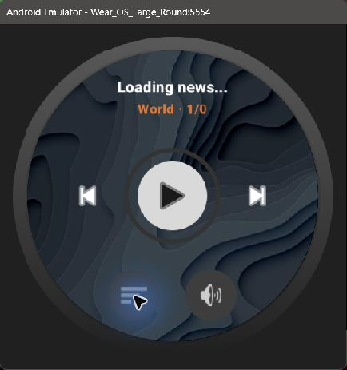
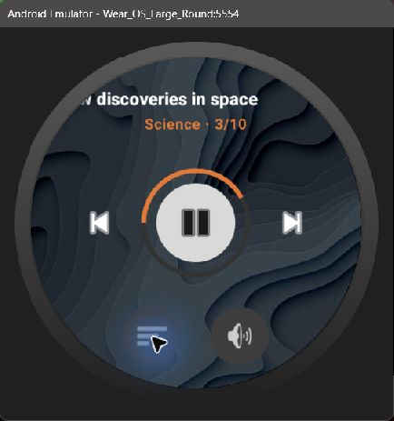
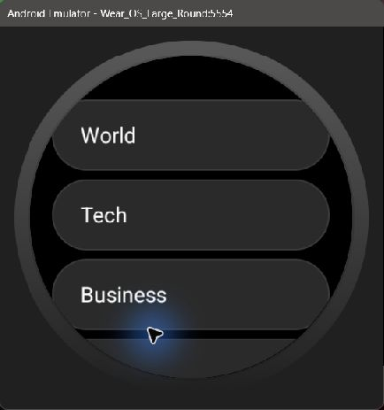
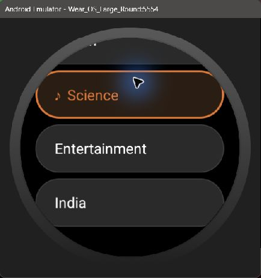
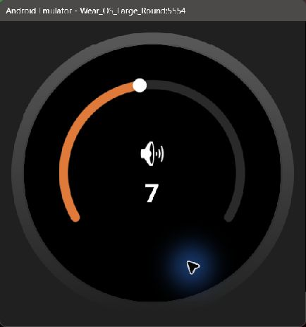
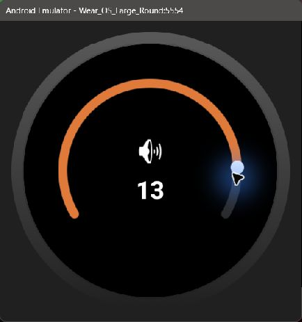
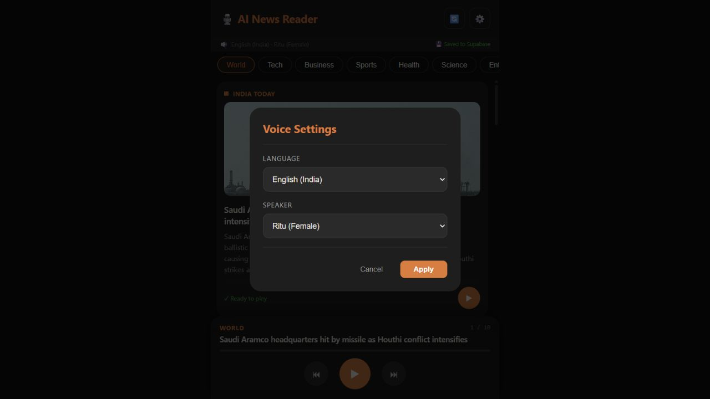
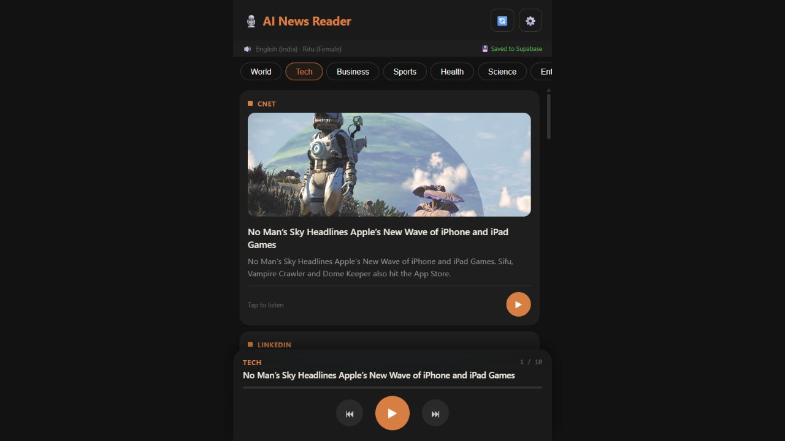

# GitHub distribution copy

This copy includes the phone, Wear OS and web source, project documentation, and screenshots. Provider credentials and release signing material have been removed. The downloadable phone debug APK has blank provider configuration and needs your own credentials configured in source and a rebuild for online news. The watch app needs a paired phone. APKs are development/distribution artifacts, not a verified production release. See [publication notes](docs/GITHUB_PUBLICATION.md).

# 🎙️ AI News Reader — Android + Wear OS

Current implementation guide (reviewed 14 October 2026): [Project documentation](docs/PROJECT_DOCUMENTATION.md) · [Offline HTML guide with screenshots](docs/PROJECT_DOCUMENTATION.html). This guide covers the phone, watch, and web app, and records current runtime limitations. The original overview below predates several implementation changes.

## Screenshots

### Wear OS watch

Captured from the native watch app running on a round Wear OS emulator. Populated player and topic screens use labeled local sample data; a paired phone and real audio playback were not tested. The volume interaction was verified locally.

| Player without phone | Player with sample state | Topic list |
| --- | --- | --- |
|  |  |  |

| Active Science topic | Volume at 7 | Volume adjusted to 13 |
| --- | --- | --- |
|  |  |  |

### Web reader

Captured from the running web application. These are browser screenshots; the native Android phone app was not captured.

| World headlines | Voice settings |
| --- | --- |
|  |  |

| Technology headlines | Audio unavailable |
| --- | --- |
|  |  |

The last web screenshot records an unsuccessful audio request caused by exhausted provider credits. The full guide explains the runtime limitations and the watch's controls and visual design.

A zero-budget AI news app that **scrapes world news → simplifies with Gemini AI → reads aloud with Sarvam TTS**, controllable from your smartwatch.

---

## 🏗️ Architecture

```
World News (GNews API)
        ↓
Gemini AI (simplifies to 2–3 sentences)
        ↓
Sarvam TTS bulbul:v3 (converts to natural speech)
        ↓
Android Phone (plays audio)
        ↕  [Wearable Data Layer]
Wear OS Watch (play/pause/next/topic controls)
```

---

## 🆓 Free API Keys Setup (Zero Budget)

### 1. GNews API — News scraping
- Go to: https://gnews.io/
- Sign up free → **100 requests/day free**
- Copy your API key

### 2. Gemini API — AI simplification
- Go to: https://aistudio.google.com/
- Sign in with Google → click **Get API Key**
- **1,500 requests/day FREE** (more than enough!)
- Copy your API key

### 3. Sarvam AI — Text to Speech
- Go to: https://dashboard.sarvam.ai/
- Sign up → copy your **API Subscription Key**

### 4. Add keys to the app
Open: `app/src/main/java/com/newsreader/data/ApiConfig.kt`

```kotlin
const val GNEWS_API_KEY  = "paste_your_gnews_key_here"
const val GEMINI_API_KEY = "paste_your_gemini_key_here"
const val SARVAM_API_KEY = "paste_your_sarvam_key_here"
```

---

## 📱 Features

### Phone App
- 📰 News from 8 topics: World, Tech, Business, Sports, Health, Science, Entertainment, India
- 🤖 AI simplifies each article to 2–3 natural sentences
- 🔊 Sarvam TTS reads news in clear Indian English (Ritu voice)
- ⏭️ Pre-fetches next article while current is playing
- 💾 Audio cached so articles don't re-fetch

### ⌚ Wear OS Watch
- ▶️ Play / Pause
- ⏭️ Next article
- ⏮️ Previous article  
- 🔄 Cycle through topics with one tap
- 📊 Shows current article title, topic, and progress
- 🔗 Shows phone connection status

---

## 🚀 Setup in Android Studio

### Requirements
- Android Studio Hedgehog (2023.1.1) or newer
- JDK 17
- Android SDK 34
- A physical Android phone (API 26+) **or** emulator
- A Wear OS watch **or** Wear OS emulator

### Steps

1. **Clone / open the project**
   ```
   File → Open → select the NewsReader folder
   ```

2. **Add your API keys** in `ApiConfig.kt` (see above)

3. **Sync Gradle**
   ```
   File → Sync Project with Gradle Files
   ```

4. **Run phone app**
   - Select the `app` module
   - Choose your phone/emulator
   - Click ▶️ Run

5. **Run watch app**
   - Select the `wear` module
   - Choose your Wear OS watch/emulator
   - Click ▶️ Run

6. **Pair phone and watch** (if using physical devices)
   - Install **Wear OS** app on phone
   - Follow pairing instructions

---

## 🔧 Wear OS Emulator Setup

1. In Android Studio → `Tools → Device Manager`
2. Click **Create Device**
3. Select **Wear OS** category
4. Choose **Wear OS Round** (30mm)
5. Select API 30+ system image
6. Start the emulator
7. Pair with phone emulator via `adb` (Android Studio guides you)

---

## 📂 Project Structure

```
NewsReader/
├── app/                          ← Phone app
│   └── src/main/java/com/newsreader/
│       ├── data/
│       │   ├── ApiConfig.kt      ← 🔑 PUT YOUR API KEYS HERE
│       │   ├── Models.kt         ← Data classes
│       │   ├── ApiInterfaces.kt  ← Retrofit interfaces
│       │   ├── RetrofitClient.kt ← HTTP client
│       │   └── NewsRepository.kt ← Fetch → Simplify → TTS pipeline
│       ├── viewmodel/
│       │   └── MainViewModel.kt  ← State management
│       ├── ui/
│       │   ├── MainActivity.kt   ← Phone UI
│       │   └── NewsAdapter.kt    ← RecyclerView adapter
│       └── service/
│           ├── AudioPlaybackService.kt    ← Background audio
│           └── WearableListenerService.kt ← Receives watch commands
│
└── wear/                         ← Watch app
    └── src/main/java/com/newsreader/wear/
        ├── WearMainActivity.kt   ← Watch UI
        ├── WearViewModel.kt      ← Watch state + send commands
        └── WearListenerService.kt ← Receives phone state
```

---

## 💡 How It Works (Step by Step)

1. App launches → loads **Top Headlines** from GNews for "World"
2. First article title is sent to **Gemini 1.5 Flash** with prompt:
   > "Simplify this news into 2-3 natural sentences for reading aloud"
3. Simplified text is sent to **Sarvam bulbul:v3** TTS API
4. Returned base64 audio is decoded and played via **MediaPlayer**
5. State (playing/paused/index/title) is sent to watch via **Wearable Data Layer**
6. Watch shows controls; tapping sends command back to phone
7. Phone executes command (play/pause/next/prev/change topic)

---

## 🎨 Customization

**Change voice:** Edit `SARVAM_SPEAKER` in `ApiConfig.kt`
- Options: `ritu`, `arvind`, `amartya`, `diya`, `neel`, `maitreyi`, `kabir`

**Change language:** Edit `SARVAM_LANGUAGE` in `ApiConfig.kt`  
- Options: `en-IN`, `hi-IN`, `ta-IN`, `te-IN`, `kn-IN`, `ml-IN`

**Change speed:** Edit `SARVAM_PACE` (0.5 = slow, 1.0 = normal, 1.5 = fast)

**Add topics:** Add entries to the `NewsTopic` enum in `ApiConfig.kt`

---

## ⚡ Troubleshooting

| Problem | Solution |
|---------|----------|
| No news loading | Check GNews API key, verify internet permission |
| AI not simplifying | Check Gemini API key, app falls back to title gracefully |  
| No audio | Check Sarvam API key and subscription |
| Watch not connecting | Ensure both apps installed, Bluetooth on, Wear OS paired |
| Build fails | Run `File → Invalidate Caches → Restart` |
